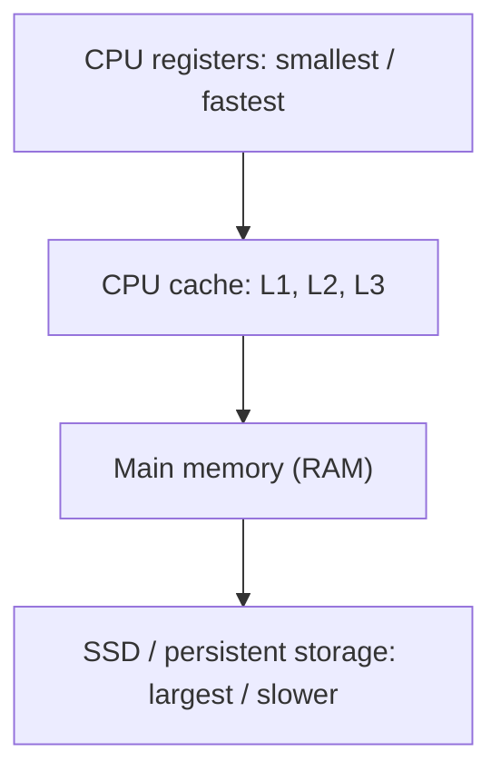

# Memory Architecture: Registers, Cache, RAM and Virtual Memory

> OS Development learning path — conceptual lesson. Study the ideas before attempting implementation.

## Learning objectives
- Compare registers, cache, RAM, and persistent storage.
- Explain cache hits and misses.
- Distinguish virtual addresses from physical addresses.

## 1. Why a hierarchy?
Fast memory is expensive and limited in capacity. Large storage is cheaper per byte but slower. Computers therefore use a **memory hierarchy**.

This is a conceptual hierarchy; actual systems differ in cache organization and memory technologies.

## 2. Cache
A cache stores copies of data or instructions likely to be used again.
- **Cache hit:** requested item is found in the cache.
- **Cache miss:** it is not found, so the system fetches it from a lower level.
- **Locality:** programs often reuse recently accessed data (temporal locality) and access nearby addresses (spatial locality).

L1 is typically smallest and fastest; L2 is usually larger; L3 is often larger and shared among cores. Details vary by CPU.

## 3. RAM and addresses
RAM holds active code and data. A process generally uses **virtual addresses**. The Memory Management Unit (MMU), guided by page tables maintained by the OS, translates virtual addresses to physical RAM addresses and enforces access permissions.

## 4. Paging in brief
Virtual memory is commonly divided into fixed-size **pages**, while physical memory is divided into **frames**. A page table maps virtual pages to physical frames. A page fault occurs when an access cannot be completed using the current mapping; it may be a normal request to bring a page into memory, or it may indicate an invalid access.

## 5. Practical observation
On your computer, compare the memory usage of several open applications in Task Manager or System Monitor. Notice that memory use changes as applications open, close, and load data.

## Knowledge check
1. What is a cache hit? **The requested item is found in that cache level.**
2. Who translates virtual addresses? **The MMU, using translation structures such as page tables.**
3. Is every page fault a crash? **No. Many are handled normally by the OS.**

## Key terms
Memory hierarchy, cache line, locality, cache hit/miss, virtual address, physical address, MMU, page, frame, page fault.

## Further reading
Study CPU cache organization and your OS's virtual-memory documentation.
