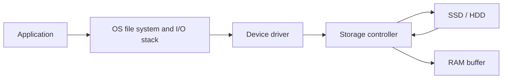

# Storage Systems: HDDs, SSDs, Interfaces and I/O

> OS Development learning path — conceptual lesson. Study the ideas before attempting implementation.

## Learning objectives
- Distinguish volatile memory from persistent storage.
- Compare HDD and SSD operation.
- Explain how an OS reads and writes storage.

## 1. Persistent storage
Storage keeps data when power is off. It holds operating systems, applications, documents, and databases. It is not a replacement for RAM: storage devices have different latency, interfaces, and access behavior.

## 2. HDD versus SSD
| Feature | HDD | SSD |
|---|---|---|
| Technology | Rotating magnetic platters and moving heads | Flash memory; no moving read head |
| Random access | Mechanical seek/rotation adds delay | Usually much faster |
| Noise/vibration | Mechanical | Silent |
| Wear | Mechanical parts can wear | Flash cells have finite program/erase endurance |

SSDs may use SATA or NVMe over PCIe. NVMe is a protocol designed for non-volatile memory devices; PCIe is the interconnect.

## 3. The I/O path

The exact path varies. Controllers commonly transfer blocks using DMA, while the CPU and OS set up requests, handle completion, and manage errors.

## 4. Blocks, files and partitions
Storage devices expose addressable blocks. A **partition** defines a region of a device; a **file system** organizes data into files and directories within a formatted volume. A file is not necessarily stored as one continuous run of blocks.

## 5. Practical observation
Check your device's storage type and capacity in the operating system's system information. Observe free space and the size of a few files. Do not repartition or format a drive as an experiment.

## Knowledge check
1. Which retains data without power: RAM or SSD? **SSD.**
2. What does NVMe describe? **A storage command protocol commonly used with PCIe SSDs.**
3. Does a file system require every file to occupy adjacent blocks? **No.**

## Key terms
HDD, SSD, flash, SATA, PCIe, NVMe, block, partition, file system, DMA.

## Further reading
Read your OS documentation for block devices and file-system concepts.
