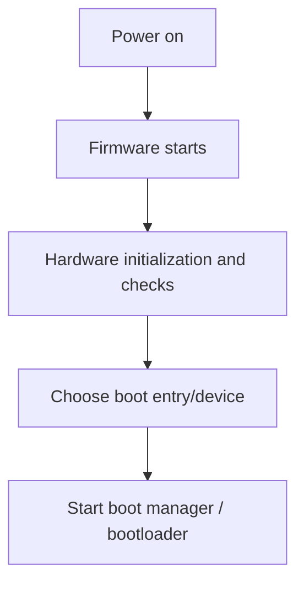

# BIOS, UEFI and Firmware

> OS Development learning path — conceptual lesson. Study the ideas before attempting implementation.

## Learning objectives
- Define firmware.
- Distinguish legacy BIOS from UEFI.
- Explain firmware's role before an OS starts.

## 1. Firmware
**Firmware** is software stored in non-volatile memory and used to control hardware. A PC's motherboard firmware initializes hardware and selects a boot target.

## 2. BIOS and UEFI
**Legacy BIOS** is the older PC firmware interface. It commonly boots using a disk's boot sector and BIOS interrupt services.
**UEFI (Unified Extensible Firmware Interface)** is the modern firmware interface. It supports structured boot entries, device drivers, GPT disks, and executable EFI applications.

UEFI is not simply a newer name for BIOS: the interfaces and boot models differ.

## 3. A simplified startup

Firmware performs platform initialization, discovers boot options, and transfers control to a selected boot application. The exact sequence depends on platform design.

## 4. Secure Boot
UEFI Secure Boot can verify signatures in the boot chain against trusted keys and policy. It helps prevent unauthorized boot components from loading, but it is not a complete security solution and does not guarantee that the whole OS is safe.

## 5. Practical observation
Enter your computer's firmware setup only if you know how to exit without saving changes. Observe whether the interface identifies itself as UEFI and note the boot order. Do not change settings for this exercise.

## Knowledge check
1. What is firmware? **Low-level software stored persistently to initialize/control hardware.**
2. What is UEFI? **A modern firmware interface and boot environment.**
3. Does Secure Boot prove an OS is vulnerability-free? **No; it verifies parts of the boot chain against configured trust policy.**

## Key terms
Firmware, BIOS, UEFI, POST, boot entry, EFI application, Secure Boot, GPT.

## Further reading
Consult your motherboard or computer manufacturer's UEFI documentation and the UEFI specification.
