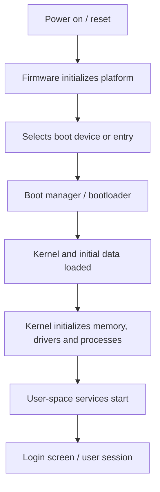

# The Boot Process: From Power Button to Login

> OS Development learning path — conceptual lesson. Study the ideas before attempting implementation.

## Learning objectives
- Describe the major stages of system startup.
- Distinguish firmware, bootloader, kernel, and user space.
- Explain why boot differs between BIOS and UEFI systems.

## 1. What is booting?
Booting is the process of preparing a computer to run an operating system after power-on or reset.

## 2. Typical high-level sequence

1. The CPU begins executing platform firmware.
2. Firmware initializes enough hardware to continue and chooses a boot option.
3. A boot manager or bootloader locates and loads the OS kernel.
4. The kernel establishes core facilities such as memory management, interrupt handling, and device support.
5. The kernel starts an initial user-space process or system manager.
6. Services and the login environment start.

## 3. BIOS versus UEFI boot
In a traditional BIOS path, firmware loads boot code from a boot sector. In a UEFI path, firmware can load an EFI executable from an EFI System Partition. Not every computer follows precisely the same path.

## 4. Why a bootloader?
The kernel may be too large or complex for firmware to load directly under older boot constraints. A bootloader can locate the kernel, load it into memory, pass configuration and hardware information, and transfer control.

## 5. Practical observation
Restart your computer and observe the manufacturer's logo, any boot menu, and the login screen. Avoid changing boot order or firmware settings.

## Knowledge check
1. Does the kernel normally start before firmware? **No. Firmware runs first.**
2. What does a bootloader do? **Loads/prepares the kernel and transfers control to it.**
3. What runs after kernel initialization? **User-space processes and services.**

## Key terms
Boot, firmware, boot manager, bootloader, kernel, init process, user space.

## Further reading
Read the boot documentation for Linux, Windows, or your computer's firmware.
