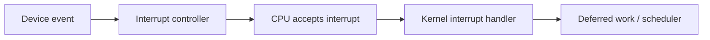

# Interrupts and Input/Output

> OS Development learning path — conceptual lesson. Study the ideas before attempting implementation.

## Learning objectives
- Explain interrupts and interrupt handlers.
- Compare polling and interrupt-driven I/O.
- Understand the role of device drivers.

## 1. What is an interrupt?
An **interrupt** is a signal or event that causes the CPU to pause its current instruction flow at a defined boundary and run an appropriate handler. Hardware devices use interrupts to notify the CPU about events such as completed I/O. CPUs also handle exceptions generated by instruction execution, such as a page fault or divide error.

## 2. Simplified interrupt path

The CPU saves enough state to handle the event, transfers control to a handler, and later resumes or schedules work. Details depend on the architecture and OS.

## 3. Polling versus interrupts
- **Polling:** the CPU repeatedly checks whether a device needs attention. It can be simple but may waste CPU time.
- **Interrupt-driven I/O:** a device signals when attention is needed. This can reduce unnecessary checking, though interrupt handling has overhead.
- **DMA:** for suitable transfers, a device can move data to/from memory without the CPU copying every byte.

## 4. Device drivers
A **device driver** is OS software that controls or communicates with a hardware device through a defined interface. Drivers translate OS requests into device-specific operations and handle events and errors.

## 5. Practical observation
Connect a USB mouse or keyboard and observe that the OS detects it. In Device Manager (Windows) or `lsusb` / system logs (Linux), inspect device information without installing unknown drivers.

## Knowledge check
1. What does an interrupt do? **Notifies the CPU that an event needs handling.**
2. What is polling? **Repeatedly checking a device's status.**
3. What is a driver? **Software that manages communication with a device.**

## Key terms
Interrupt, exception, interrupt handler, interrupt controller, polling, DMA, device driver, I/O.

## Further reading
Read your OS documentation on interrupt handling and device drivers.
