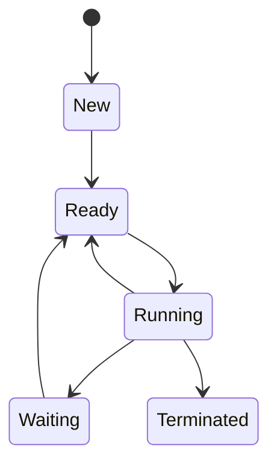

# Processes and Threads

> OS Development learning path — conceptual lesson. Study the ideas before attempting implementation.

## Learning objectives
- Distinguish a program from a process.
- Explain the role of threads.
- Identify common process states.

## 1. Program versus process
A **program** is a passive set of instructions stored as a file. A **process** is a running instance with an address space and OS-managed resources such as open files and security credentials.

## 2. What is a thread?
A **thread** is an execution path within a process. Threads in the same process generally share its address space and resources, but each thread has its own stack and CPU execution state. A process can contain one or many threads.

## 3. Typical process states

- **Ready:** able to run, waiting for CPU time.
- **Running:** currently executing on a CPU core.
- **Waiting/Blocked:** waiting for an event such as I/O completion.
- **Terminated:** finished or stopped.

## 4. Why use multiple threads?
Threads can keep a user interface responsive, perform background work, or use multiple CPU cores. Shared memory makes communication efficient but introduces race conditions if access is not synchronized.

## 5. Practical observation
Open Task Manager or System Monitor and inspect the processes and thread counts of running applications. Avoid ending system processes you do not recognize.

## Knowledge check
1. Is a program file itself a process? **No; a process is a running instance.**
2. What do threads in one process commonly share? **The process address space and many process resources.**
3. What is a race condition? **A result that depends on the timing/interleaving of concurrent operations.**

## Key terms
Program, process, thread, address space, ready, running, blocked, race condition, synchronization.

## Further reading
Study process and thread APIs in Linux or Windows.
