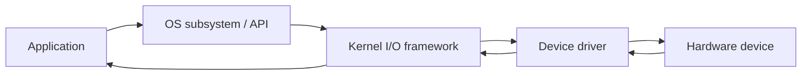

# Device Drivers: How the OS Controls Hardware

> OS Development learning path — conceptual lesson. Study the ideas before attempting implementation.

## Learning objectives
- Define a device driver.
- Explain how drivers connect OS services to hardware.
- Recognize why driver compatibility and security matter.

## 1. What is a driver?
A **device driver** is software that allows an operating system to communicate with a hardware device. It implements a defined interface and translates OS requests into device-specific commands or operations.

## 2. Typical interaction

Applications generally do not need to know the exact registers or commands of every device. The OS and driver provide abstraction.

## 3. Driver types and placement
Some drivers run in kernel space; others use user-space frameworks. Kernel-mode drivers can have broad privileges, so a bug may crash or compromise the system. User-space drivers can improve isolation in some designs, but the trade-offs depend on the OS.

## 4. Plug and Play
Modern OSes detect devices, identify hardware, match suitable drivers, and configure resources. A device may work using a built-in generic driver or require a vendor-provided driver.

## 5. Practical observation
Open Device Manager on Windows or inspect hardware information on Linux. Look at device names and driver details. Do not download drivers from untrusted sites.

## Knowledge check
1. Why do drivers exist? **To provide OS-to-device communication and hide hardware-specific details.**
2. Why can a kernel driver bug be serious? **It executes with high privilege and can affect system stability/security.**
3. Should you install a driver from an unknown download site? **No; use trusted OS or manufacturer sources.**

## Key terms
Device driver, kernel mode, user space, Plug and Play, hardware identifier, I/O subsystem.

## Further reading
Read Microsoft's driver documentation or the Linux kernel driver model documentation.
