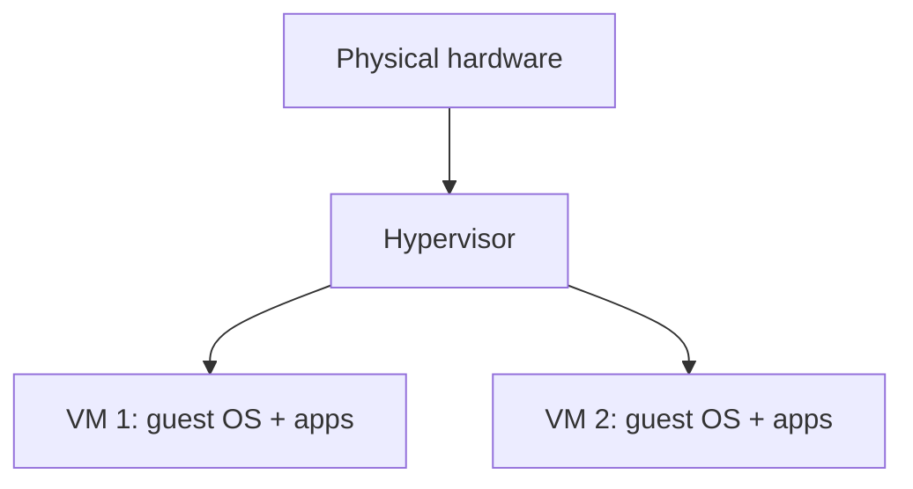

# Virtualization: Running Virtual Machines

> OS Development learning path — conceptual lesson. Study the ideas before attempting implementation.

## Learning objectives
- Define virtualization and a virtual machine.
- Distinguish Type 1 and Type 2 hypervisors.
- Explain virtual CPU, memory, and devices.

## 1. What is virtualization?
**Virtualization** uses software and hardware support to create an environment that behaves like a separate computer. A **virtual machine (VM)** runs a guest operating system using virtualized CPU, memory, storage, and devices.

## 2. Hypervisors
A **hypervisor** creates and manages virtual machines.
- **Type 1 (bare-metal):** runs directly on the host hardware.
- **Type 2 (hosted):** runs as an application on a host operating system.

The distinction is a useful model; real products can have more nuanced architectures.

## 3. Conceptual layout

A hosted hypervisor adds a host OS layer between hardware and the hypervisor application.

## 4. Why use VMs?
- Test operating systems safely.
- Run software requiring another OS.
- Consolidate servers.
- Create repeatable lab environments.
- Take snapshots before experiments.

A VM is not automatically safe: shared folders, clipboard integration, network access, and hypervisor vulnerabilities can create paths between guest and host.

## 5. VM versus container
A VM normally virtualizes hardware and runs its own guest kernel. A container isolates processes while sharing the host kernel. Containers are usually lighter, but they do not provide the same kernel boundary as a separate VM.

## 6. Practical observation
If you already use VMware or VirtualBox, inspect the VM's virtual CPU, RAM, and disk settings. Do not allocate more resources than your host can comfortably provide.

## Knowledge check
1. What manages VMs? **A hypervisor.**
2. Does a typical container run its own independent kernel? **No; it shares the host kernel.**
3. Are VMs perfectly isolated? **No; isolation depends on configuration and hypervisor security.**

## Key terms
Virtualization, virtual machine, guest OS, host OS, hypervisor, Type 1, Type 2, container, snapshot.

## Further reading
Read the VMware, VirtualBox, Hyper-V, or KVM documentation.
